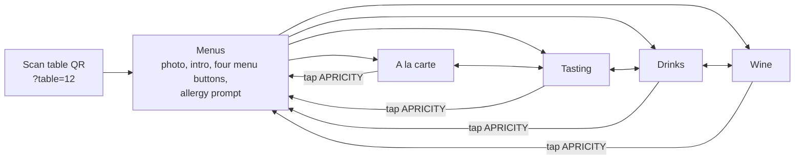

# Apricity table menu mockup

A phone-first menu that guests open by scanning the QR code on their table.

- `index.html`: open it in a browser (or a phone-sized dev-tools window). Add `?table=12` to the URL to see how a table-specific QR code works.
- `src/menu.html` + `src/dishes.jpg`: the source used for the hosted preview. Edit these, then run `./build.sh` to regenerate `index.html`.

## Content

All menu content and messaging is copied from apricityrestaurant.com (captured 25 Oct 2026): the menus intro, the à la carte, tasting and drinks menus, the allergen key and trace warning, the 13.5% 'Apriciation' note, the 50p School Food Matters donation and the Belu water note. The hero photo is the one on the website's Menus page.

Not included yet:
- **Wine list.** The website loads it from a separate feed, so it was missing from the PDF. The Wine tab shows the site's intro and a marked placeholder.
- **Culinary Kids menu.** It's linked from the Menus page, but its content wasn't supplied.

## Visual style (matched to the website)

- White page, dark grey text (#272727), grey secondary text (#676767), pale grey rules.
- `APRICITY` wordmark in widely spaced, light capitals in the brand peach (#FFB7AB), with a thin rule underneath.
- Light geometric sans throughout. The site uses Brandon Grotesque Light (a licensed font), so the mockup uses Jost Light for text and Josefin Sans for the wordmark (the site also uses Josefin Sans). Swap in the licensed Brandon webfont for production.
- Small, letter-spaced uppercase headings, a centred narrow column and plenty of white space.
- Allergen codes in small grey type after each dish, as on the site. P-B (plant-based) gets a soft peach highlight.
- Peach is used for selection only (active tab underline, selected tasting menu, plant-based filter). A dark version follows the phone's setting for dim dining rooms.

## User flow

1. **Scan → Menus.** It mirrors the website's Menus page: the dish photo, the intro copy, then four large buttons (A la carte, Tasting menus, Drinks, Wine list), the same four the website offers. The table number from the QR code shows top right. An allergy prompt sits underneath, so guests see it before choosing.
2. **One tap to any menu.** A sticky tab bar (A la carte · Tasting · Drinks · Wine) uses the website's menu names and order, so guests can switch between food and drinks from anywhere.
3. **Find the section.** Below the tabs, a row of section buttons (Bread, Starters, Mains, Sides, Puddings, or Today's cocktails, To start, Soft…) jumps to a section. The button for the section on screen lights up as the guest scrolls.
4. **Plant-based only.** This filter is on both food menus. It reflects Apricity's message that every tasting course has a plant-based option. It hides non-plant-based dishes, and the phone remembers the choice.
5. **Tasting menus.** Guests tap 5-course or 7-course. Each shows the full price and the lunch & early evening price, plus the conditions. The course list then shows only that menu's courses. On the 5-course menu, the cheese course appears as an £8 add-on. Supplements, pairings (with the number of glasses) and sides follow.
6. **Getting back.** The phone's back button moves between menus. Tapping APRICITY returns to the Menus screen.
7. **Every menu ends** with the allergen key and trace warning (food menus), the Apriciation note and the School Food Matters donation, worded as on the website.
