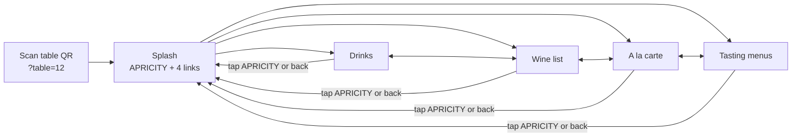

# Apricity table menu mockup

A phone-first menu that guests open by scanning the QR code on their table.

- `index.html`: open it in a browser (or a phone-sized dev-tools window). Add `?table=12` to the URL to see how a table-specific QR code works.
- `src/menu.html`: the source used for the hosted preview. Edit it, then run `./build.sh` to regenerate `index.html`.

## Content

All menu content is copied from apricityrestaurant.com (captured 25 Oct 2026): the menus intro, the à la carte, tasting and drinks menus, the allergen key and trace warning, the 13.5% 'Apriciation' note, the 50p School Food Matters donation and the Belu water note.

The wine list (149 wines: by the glass and bottles, with ♢ "unique expression" markers, grapes, regions and sweet-wine glass prices) was extracted from a saved copy of the website's wine-list page.

Not included yet:
- **Culinary Kids menu.** It's linked from the Menus page, but its content wasn't supplied.

## Visual style

- The site's peach (#F9C6BA) everywhere, with black text and thin black rules. No teal, no photo, no intro paragraphs.
- Josefin Sans, the fallback font the website itself names after Brandon Grotesque (a licensed font).
- Selected tabs are underlined, as in the site's navigation. Selected chips and buttons are filled black.
- Dark mode is a warm dark brown with peach text.

## User flow

1. **Scan → splash.** Only the wordmark, the table number, four links (Drinks, Wine list, A la carte, Tasting menus) and one allergy line. No photo and no intro text.
2. **Switch menus in one tap.** Inside a menu, the header shows *Drinks · Wine | A la carte · Tasting*, so guests never have to go back to the splash. Each drinks list ends with "Food menu →" and each food list ends with "Drinks →".
3. **Find the section.** Chips under the tabs jump to sections. The chip for the section on screen is highlighted as the guest scrolls.
4. **Wine.** By the glass first, then bottles by style.
5. **Food.** One short allergy line and a Plant-based filter chip (remembered on the phone). Allergen codes sit beside each dish, and the full key is folded away at the bottom.
6. **Tasting.** Two buttons (5 courses £85 / 7 courses £99, with the lunch & early-evening prices) switch the course list and the pairing prices together.
7. **Getting back.** Tap APRICITY or use the phone's back button to return to the splash.

## What was cut for clarity

Hero photo, menu intro paragraphs, the long Apriciation and School Food Matters paragraphs (now one line), the non-alcoholic pairing description and spirits blurb, the "♢ unique only" wine filter and the teal bands.
