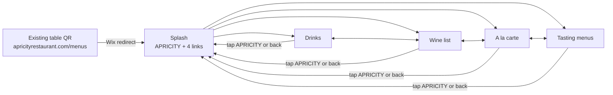

# Apricity table menu mockup

A phone-first menu that guests open by scanning the QR code on their table.

- `index.html`: the menu page. It loads its content, so open it through a web server rather than as a file, e.g. `python3 -m http.server` then http://localhost:8000/.
- `sheets/*.csv`: the menu content, one file per Google Sheet tab. Import these to create the sheet.
- `UPDATING-THE-MENU.md`: the guide for staff.
- `accessibility/`: the accessibility comparison with the current website, raw results and the audit script.
- `src/menu.html`: the source used for the hosted preview. Edit it, then run `./build.sh` to regenerate `index.html`.

## Menu content lives in Google Sheets

Staff update the menu in a Google Sheet, never in code. The page fetches each tab as CSV when a guest opens a menu, so changes appear within about 5 minutes. Rows with *Show* = `no` are hidden, which makes it quick to take a dish off for the night. See `UPDATING-THE-MENU.md`.

**One-off setup**
1. Create a Google Sheet called *Apricity menus*. Import each file from `sheets/` as its own tab (File → Import → Upload → *Insert new sheet*): Drinks, A la carte, Tasting, Tasting prices. The wine list already lives in its own sheet.
2. File → Share → Publish to web. For each tab, choose the tab and *Comma-separated values (.csv)*, then copy the link.
3. Paste the links into `SHEETS` at the top of the script in `src/menu.html`, then run `./build.sh`.
4. For the wine list, point `SHEETS.wine` at the existing wine sheet's published CSV. The page expects the columns *Serve* (Glass/Bottle), *Section*, *Unique* (♢), *Vintage*, *Producer*, *Cuvée*, *Grapes*, *Region*, *Price*, *Glass price* and *Show*. If the existing sheet uses other headings, rename them or change the names in the `wine()` function.
5. Host it. The repo root is the site (`index.html`, `sheets/`), so GitHub Pages can serve it as is. The menu is live at https://lululaplap.github.io/apricity-mocks/.
6. Keep the existing QR codes. They open apricityrestaurant.com/menus, so move the website's Menus page to a new address and redirect `/menus` to this menu. See *Switching over, and switching back* below.

If a sheet can't be reached, the page says the menu didn't load and offers *Try again*. It never shows stale or made-up content.

## Switching over, and switching back

The QR codes on the tables open `apricityrestaurant.com/menus`, which is also the website's Menus page. To send QR scans to this menu without changing the website, the website page moves to a new address and `/menus` is redirected here. Nothing is deleted, so switching back restores today's set-up exactly.

**Switching over (about 10 minutes)**
1. In the Wix editor, open the Menus page's settings and change its URL from `menus` to `our-menus`.
2. Check that the website's Menus link now opens `/our-menus`. Wix menus link to pages, not addresses, so it should follow automatically.
3. In the Wix dashboard, open **SEO settings → URL Redirect Manager** and add a single redirect from `/menus` to this menu's full address ([Wix help](https://support.wix.com/en/article/setting-up-301-redirects)). If Wix created a redirect from `/menus` to `/our-menus` in step 1, edit that one instead.
4. Scan a table QR code and check it opens this menu.

**Switching back (about 5 minutes)**
1. In **URL Redirect Manager**, delete the `/menus` redirect.
2. In the Wix editor, change the Menus page's URL back from `our-menus` to `menus`. Delete any redirect Wix offers to create from `/our-menus`.
3. Scan a table QR code and check it opens the website's Menus page again.

Effect on the website: visitors see no change, because the site's navigation follows the page to its new address. Only old links to `/menus` from outside the site (such as search results) open this menu while the redirect is in place.

To keep switching back instant, keep the website's menu pages in Wix up to date during the trial, as today. If this menu is adopted, the website's menu pages could later read the same Google Sheet, leaving one place to update.

## Content

The starting content in `sheets/` is copied from apricityrestaurant.com (captured 25 Oct 2026): the menus intro, the à la carte, tasting and drinks menus, the allergen key and trace warning, the 13.5% 'Apriciation' note, the 50p School Food Matters donation and the Belu water note.

The wine list (149 wines: by the glass and bottles, with ♢ "unique expression" markers, grapes, regions and sweet-wine glass prices) was extracted from a saved copy of the website's wine-list page.

Not included yet:
- **Culinary Kids menu.** It's linked from the Menus page, but its content wasn't supplied.

## Visual style

- The site's peach (#F9C6BA) everywhere, with black text and thin black rules. No teal, no photo, no intro paragraphs.
- Josefin Sans, the fallback font the website itself names after Brandon Grotesque (a licensed font).
- Selected tabs are underlined, as in the site's navigation. Selected chips and buttons are filled black.
- Always light: no dark mode, and the page asks browsers not to darken it automatically.

## User flow

1. **Scan → splash.** The existing QR codes still work, through a redirect from /menus. The splash has only the wordmark, four links (Drinks, Wine list, A la carte, Tasting menus) and one allergy line. No photo and no intro text.
2. **Switch menus in one tap.** Inside a menu, the header shows *Drinks · Wine | A la carte · Tasting*, so guests never have to go back to the splash. Each drinks list ends with "Food menu →" and each food list ends with "Drinks →".
3. **Find the section.** Chips under the tabs jump to sections. The chip for the section on screen is highlighted as the guest scrolls.
4. **Wine.** By the glass first, then bottles by style.
5. **Food.** One short allergy line and a Plant-based filter chip (remembered on the phone). Allergen codes sit beside each dish, and the full key is folded away at the bottom.
6. **Tasting.** Two buttons (5 courses £85 / 7 courses £99, with the lunch & early-evening prices) switch the course list and the pairing prices together.
7. **Getting back.** Tap APRICITY or use the phone's back button to return to the splash.

## Accessibility

Older guests are a key audience, so the page sets a floor stricter than WCAG 2.2 AA:
- No text under 14px (body 17px), regular weight or heavier, and text contrast of at least 6.7:1 on the peach.
- Every tab, section button and link is at least 44px tall.
- A *Larger text* button (115%, then 132%) on the start page and at the end of every menu, remembered on the phone. Every size is in rem, so it scales everything, and the page still fits a 320px screen at the largest size.
- Allergen codes are read out in words by screen readers ("plant-based; contains mustard"), and the allergy note links to the code key.
- Real headings and landmarks; the current menu tab carries `aria-current`; focus moves to the menu title after switching; loading and error messages are announced.
- No dark mode, and no animated scrolling when the phone asks for reduced motion. Pinch zoom stays enabled.

axe-core 4.10 (WCAG 2.0–2.2 A/AA and best-practice rules) reports no issues on any of the five screens. The comparison with the current website, the before-and-after results and the audit script are in [`accessibility/`](accessibility/REPORT.md). Run it again after design changes.

## What was cut for clarity

Hero photo, menu intro paragraphs, the long Apriciation and School Food Matters paragraphs (now one line), the non-alcoholic pairing description and spirits blurb, the "♢ unique only" wine filter and the teal bands.
