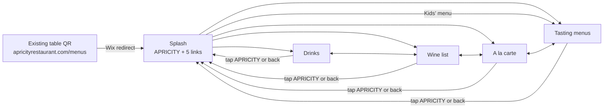

# Apricity table menu mockup

A phone-first menu that guests open by scanning the QR code on their table.

- `chefs-table.html`: the Chefs' Table menu, for that table's own QR code. See *Chefs' Table* below.
- `index.html`: the menu page. It loads its content, so open it through a web server rather than as a file, e.g. `python3 -m http.server` then http://localhost:8000/.
- `sheets/*.csv`: copies of each Google Sheet tab, read only by the preview and local testing. The live pages read the Google Sheets.
- `UPDATING-THE-MENU.md`: the guide for staff.
- `accessibility/`: the accessibility comparison with the current website, raw results and the audit script.
- `screenshots/`: before-and-after phone screenshots and task boards showing the journey improvements.
- `src/menu.html`: the source used for the hosted preview. Edit it, then run `./build.sh` to regenerate `index.html`.

## Problems guests have at the table, and how this menu solves them

The team sees these problems again and again during service.

| What guests struggle with today | What this menu does |
| --- | --- |
| **Losing their place.** Guests find the wine they want, look at the food, then can't find the wine again when it's time to order drinks. | Each menu remembers where the guest was. Switch to the food and back, and the wine list reopens at the same wine (tabs, end-of-list links and the back button all work). Two buttons, *By the glass* and *Bottles*, reach any part of the wine list; *Bottles* opens into a button per style. |
| **Vegan guests overwhelmed, and unsure what is plant-based.** They scan every dish for a small "P-B" code. On the tasting menu there's often only one dish per course they can have, and that isn't obvious. | A *Plant-based* button hides everything else, on the a la carte and all tasting menus, and the phone remembers it. While it's on, the button stays pinned at the left of the section row, filled black, so guests can always see the filter is on. With it on, each tasting course shows its single plant-based dish, so a vegan guest sees their menu rather than choices they can't have. "P-B" is printed in bold on every dish. |
| **Older guests struggling to read.** Thin, small, grey lettering, in a softly lit dining room, often without reading glasses. | At least 14px text (main text 17px), never thin, with contrast of at least 6.7:1 (the website: down to 12px, mostly thin, 3.6:1). A *Larger text* button (115% and 132%) on the start page and at the end of every menu, and tap targets of at least 44px. See [`accessibility/`](accessibility/REPORT.md). |
| **Unsure how many choices to make on the tasting menu.** The website shows the 5- and 7-course menus on one page, in one list, with 7-course-only courses marked "(for 7-courses)" and "*" inside it. Guests have to work out which courses, and how many choices, apply to them. | Guests tap *5 courses*, *7 courses* or *Kids*, and only that menu's courses show, under a heading such as "5-course menu" and a clear line, "Choose one dish from each course", with an **or** between each course's dishes so it's clear a choice is needed. The 7-course extras disappear from the 5-course menu, apart from the cheese course, which shows its dishes in full under an *Optional · £8 extra* label. The price, lunch price and pairings change with the choice. |

The plant-based filter follows the restaurant's own "P-B" codes. Guests with a strict vegan diet or an allergy should still check with their server.

## Menu content lives in Google Sheets

Staff update the menu in a Google Sheet, never in code. The page fetches each tab as CSV when a guest opens a menu, so changes appear within about 5 minutes. Rows with *Show* = `no` are hidden, which makes it quick to take a dish off for the night. See `UPDATING-THE-MENU.md`.

**One-off setup**
1. The **Apricity menus** Google Sheet is in Google Drive, with one tab per menu: Drinks, A la carte, Tasting, Kids, Tasting prices, Chefs table, Chefs table details. (Starting again: import each file from `sheets/` as its own tab.)
2. In the Google Sheet, File → Share → Publish to web, *Entire document*, *Web page*, then *Publish*. Copy the link.
3. In `build.sh`, set `MENUS` to that link up to `/pub` (it starts `https://docs.google.com/spreadsheets/d/e/2PACX-`), and each `…_GID` to that tab's number: click the tab and copy the number after `#gid=` in the address bar. Run `./build.sh`, which points `index.html` and `chefs-table.html` at the sheet. Any tab left blank keeps reading its copy in `sheets/`.
4. The wine list is already connected. The live pages read the restaurant's existing published **apricity_wines** sheet as it is (columns *Section*, *Subsection*, *Unique Expression (♢)*, *Vintage*, *Producer*, *Cuvée*, *Grape Varieties*, *Region*, *Bottle Price (£)*, *Glass Price (£)*, *Glass Size*). The preview and local testing read the copy in `sheets/wine.csv` (taken from the sheet on 28 Oct 2026).
5. Host it. The repo root is the site (`index.html`, `chefs-table.html`), so GitHub Pages can serve it as is. The menu is live at https://lululaplap.github.io/apricity-mocks/.
6. Keep the existing QR codes. They open apricityrestaurant.com/menus, so move the website's Menus page to a new address and redirect `/menus` to this menu. See *Switching over, and switching back* below.

If a sheet can't be reached, the page says the menu didn't load and offers *Try again*. It never shows stale or made-up content.

## Chefs' Table

`chefs-table.html` is a separate set of pages for the Chefs' Table, built from the same source (`./build.sh` writes both). It has:
- a start page with the welcome line, the date and a personal message (for example a birthday), then links to *Tonight's menu*, *Drinks* and *Wine list*;
- tabs for *Chefs' table · Drinks · Wine*, with no a la carte or tasting menus;
- tonight's courses as a numbered list, with the message repeated at the top;
- the same Drinks and Wine pages and sheets as the main menu.

Staff set it up for each booking in two sheet tabs: **Chefs table** (one row per course: *Dish*, *Description*, *Allergens*, *Show*) and **Chefs table details** (*Item* and *Text* rows for *Welcome*, *Date* and *Message*). Leave *Message* blank for no message. The Chefs' Table needs its own QR code pointing at `chefs-table.html`, or at a Wix redirect from the address its current QR code uses.

## Switching over, and switching back

The QR codes on the tables open `apricityrestaurant.com/menus`, which is also the website's Menus page. To send QR scans to this menu without changing the website, the website page moves to a new address and `/menus` is redirected here. Nothing is deleted, so switching back restores today's set-up exactly.

**Switching over (about 10 minutes)**
1. In the Wix editor, open the Menus page's settings and change its URL from `menus` to `our-menus`.
2. Check that the website's Menus link now opens `/our-menus`. Wix menus link to pages, not addresses, so it should follow automatically.
3. In the Wix dashboard, open **SEO settings → URL Redirect Manager** and add a single redirect from `/menus` to this menu's full address ([Wix help](https://support.wix.com/en/article/setting-up-301-redirects)). If Wix created a redirect from `/menus` to `/our-menus` in step 1, edit that one instead.
4. Scan a table QR code and check it opens this menu.

**Switching back (about 5 minutes)**
1. In **URL Redirect Manager**, delete the `/menus` redirect.
2. In the Wix editor, change the Menus page's URL back from `our-menus` to `menus`. Delete any redirect Wix offers to create from `/our-menus`.
3. Scan a table QR code and check it opens the website's Menus page again.

Effect on the website: visitors see no change, because the site's navigation follows the page to its new address. Only old links to `/menus` from outside the site (such as search results) open this menu while the redirect is in place.

To keep switching back instant, keep the website's menu pages in Wix up to date during the trial, as today. If this menu is adopted, the website's menu pages could later read the same Google Sheet, leaving one place to update.

## Content

The starting content in `sheets/` is copied from apricityrestaurant.com (captured 25 Oct 2026): the menus intro, the à la carte, tasting and drinks menus, the allergen key and trace warning, the 13.5% 'Apriciation' note, the 50p School Food Matters donation and the Belu water note.

The wine list comes from the restaurant's own published wine sheet (148 wines on 28 Oct 2026), the same sheet that feeds the website's wine list, so the two always match.

The Culinary Kids' tasting menu (£36, five courses, up to age 12) was taken from a saved copy of its website page (26 Oct 2026). The website doesn't name its courses, so the course names follow the adult tasting menu.

## Visual style

- The logo from the brand's logo pack, in black, on the start page and in the header. It's a 1.8KB vector (`brand/apricity-logo.svg`, traced from the pack's PNG) drawn once inside the page, so it needs no extra download and stays sharp at every text size.

- The site's peach (#F9C6BA) everywhere, with the website's colours: black text (13.8:1 on the peach), its dark grey #3A3A3A (7.5:1), and #414141 in place of its light grey #6A6A6A, which fails contrast (3.6:1). The logo is black too. No teal bands or backgrounds, no photo, no intro paragraphs.
- Josefin Sans, the fallback font the website itself names after Brandon Grotesque (a licensed font).
- Selected tabs are underlined, as in the site's navigation. Selected chips and buttons are filled black.
- Always light: no dark mode, and the page asks browsers not to darken it automatically.

## User flow

1. **Scan → splash.** The existing QR codes still work, through a redirect from /menus. The splash has only the wordmark, five links (Drinks, Wine list, A la carte, Tasting menus, Kids' menu), one allergy line and the *Larger text* button. No photo and no intro text.
2. **Switch menus in one tap.** Inside a menu, the header shows *Drinks · Wine | A la carte · Tasting*, so guests never have to go back to the splash. Each drinks list ends with "Food menu →" and each food list ends with "Drinks →".
3. **Find the section.** Chips under the tabs jump to sections. The chip for the section on screen is highlighted as the guest scrolls.
4. **Table water.** The Drinks page opens with a boxed notice, worded as on the website: "Unlimited Belu still or sparkling water - £2.50 per person", then the WaterAid line. It comes from a *Note* row in the Drinks sheet.
5. **Wine.** By the glass first, then bottles by style. The section row has just two buttons, *By the glass* and *Bottles*. Tapping *Bottles* jumps to the bottles and opens it into a button per style (Sparkling, Champagne, White: Aromatic & Fresh…), which slide out one after another. It stays open while the guest is anywhere in the bottles, closes again back in *By the glass*, and turns off its animation for guests whose phone asks for reduced motion.
6. **Food.** One short allergy line and a Plant-based filter chip (remembered on the phone). Allergen codes sit beside each dish, and the full key is folded away at the bottom.
7. **Tasting.** Three buttons (5 courses £85, 7 courses £99, Kids £36) switch the course list and the drinks pairing prices (wine and non-alcoholic) together. The *Kids' menu* link on the splash opens this screen with Kids selected; pairings and sides are hidden for the kids' menu.
8. **Keeping your place.** Each menu remembers where the guest was. Find a wine, check the food, tap *Wine* again and the list opens at that wine, not the top (the back button does the same). Places are kept for the browser session, so they survive the phone reloading the page after switching apps. Tapping the tab you're already on still scrolls to the top.
9. **Getting back.** Tap APRICITY or use the phone's back button to return to the splash.

## Accessibility

Older guests are a key audience, so the page sets a floor stricter than WCAG 2.2 AA:
- No text under 14px (body 17px), regular weight or heavier, and text contrast of at least 6.7:1 on the peach.
- Every tab, section button and link is at least 44px tall.
- A *Larger text* button (115%, then 132%) on the start page and at the end of every menu, remembered on the phone. Every size is in rem, so it scales everything, and the page still fits a 320px screen at the largest size.
- Allergen codes are read out in words by screen readers ("plant-based; contains mustard"), and the allergy note links to the code key.
- Real headings and landmarks; the current menu tab carries `aria-current`; focus moves to the menu title after switching; loading and error messages are announced.
- No dark mode, and no animated scrolling when the phone asks for reduced motion. Pinch zoom stays enabled.

axe-core 4.10 (WCAG 2.0–2.2 A/AA and best-practice rules) reports no issues on any of the five screens. The comparison with the current website, the before-and-after results and the audit script are in [`accessibility/`](accessibility/REPORT.md). Run it again after design changes.

## What was cut for clarity

Hero photo, menu intro paragraphs, the non-alcoholic pairing description and spirits blurb, the "♢ unique only" wine filter and the teal bands.
