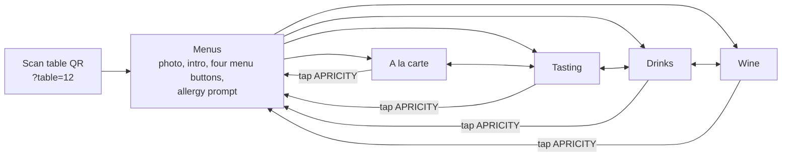

# Apricity table menu mockup

A phone-first menu that guests open by scanning the QR code on their table.

- `index.html`: open it in a browser (or a phone-sized dev-tools window). Add `?table=12` to the URL to see how a table-specific QR code works.
- `src/menu.html` + `src/dishes.jpg`: the source used for the hosted preview. Edit these, then run `./build.sh` to regenerate `index.html`.

## Content

All menu content and messaging is copied from apricityrestaurant.com (captured 25 Oct 2026): the menus intro, the à la carte, tasting and drinks menus, the allergen key and trace warning, the 13.5% 'Apriciation' note, the 50p School Food Matters donation and the Belu water note. The hero photo is the one on the website's Menus page.

The wine list (149 wines: by the glass and bottles, with ♢ "unique expression" markers, grapes, regions and sweet-wine glass prices) was extracted from a saved copy of the website's wine-list page.

Not included yet:
- **Culinary Kids menu.** It's linked from the Menus page, but its content wasn't supplied.

## Visual style (matched to the website)

- Deep teal header band (#034852) with the light, widely spaced `APRICITY` wordmark in peach. Peach page (#F9C6BA) with black text and #3A3A3A secondary text. A teal footer closes each page, as on the site.
- Josefin Sans throughout, which is the fallback font the website itself names after Brandon Grotesque (a licensed font). Swap in Brandon for production if licensed.
- Letter-spaced uppercase headings, centred page titles, thin black rules under section headings and faint rules between items, all taken from the site's wine-list styles.
- Menu tabs mirror the site's navigation: uppercase links with the current one underlined.
- Wine rows use the site's format: vintage, **producer** / cuvée, then grapes and region in smaller type.
- Allergen codes in small grey type after each dish. P-B (plant-based) is picked out in teal.
- Teal marks what the guest has selected (tasting menu, glass or bottle, filters). In dark mode the page turns teal with peach text, which suits a dim dining room.

## User flow

1. **Scan → Menus.** It mirrors the website's Menus page: the dish photo, the intro copy, then four large buttons (A la carte, Tasting menus, Drinks, Wine list), the same four the website offers. The table number from the QR code shows top right. An allergy prompt sits underneath, so guests see it before choosing.
2. **One tap to any menu.** A sticky tab bar (A la carte · Tasting · Drinks · Wine list) uses the website's menu names and order, so guests can switch between food and drinks from anywhere.
3. **Find the section.** Below the tabs, a row of section buttons (Bread, Starters, Mains, Sides, Puddings, or Today's cocktails, To start, Soft…) jumps to a section. The button for the section on screen lights up as the guest scrolls.
4. **Plant-based only.** This filter is on both food menus. It reflects Apricity's message that every tasting course has a plant-based option. It hides non-plant-based dishes, and the phone remembers the choice.
5. **Wine list.** Switch between *By the glass* (125ml) and *Bottles* (750ml). Section buttons jump to Sparkling, Champagne, White: Aromatic & Fresh, and so on. A "♢ Unique only" filter shows just the wines the site marks as unique expressions.
6. **Tasting menus.** Guests tap 5-course or 7-course. Each shows the full price and the lunch & early evening price, plus the conditions. The course list then shows only that menu's courses. On the 5-course menu, the cheese course appears as an £8 add-on. Supplements, pairings (with the number of glasses) and sides follow.
7. **Getting back.** The phone's back button moves between menus. Tapping APRICITY returns to the Menus screen.
8. **Every menu ends** with the allergen key and trace warning (food menus), the Apriciation note and the School Food Matters donation, worded as on the website, in the teal footer.
