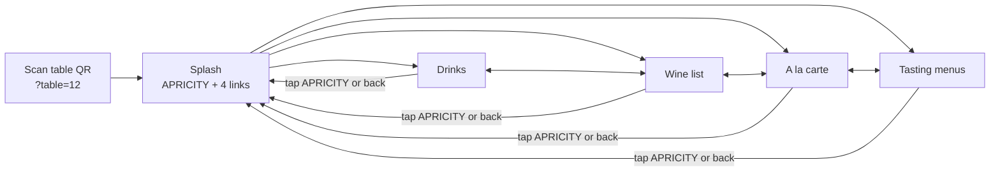

# Apricity table menu mockup

A phone-first menu that guests open by scanning the QR code on their table.

- `index.html`: the menu page. It loads its content, so open it through a web server rather than as a file, e.g. `python3 -m http.server` then http://localhost:8000/?table=12.
- `sheets/*.csv`: the menu content, one file per Google Sheet tab. Import these to create the sheet.
- `UPDATING-THE-MENU.md`: the guide for staff.
- `src/menu.html`: the source used for the hosted preview. Edit it, then run `./build.sh` to regenerate `index.html`.

## Menu content lives in Google Sheets

Staff update the menu in a Google Sheet, never in code. The page fetches each tab as CSV when a guest opens a menu, so changes appear within about 5 minutes. Rows with *Show* = `no` are hidden, which makes it quick to take a dish off for the night. See `UPDATING-THE-MENU.md`.

**One-off setup**
1. Create a Google Sheet called *Apricity menus*. Import each file from `sheets/` as its own tab (File → Import → Upload → *Insert new sheet*): Drinks, A la carte, Tasting, Tasting prices. The wine list already lives in its own sheet.
2. File → Share → Publish to web. For each tab, choose the tab and *Comma-separated values (.csv)*, then copy the link.
3. Paste the links into `SHEETS` at the top of the script in `src/menu.html`, then run `./build.sh`.
4. For the wine list, point `SHEETS.wine` at the existing wine sheet's published CSV. The page expects the columns *Serve* (Glass/Bottle), *Section*, *Unique* (♢), *Vintage*, *Producer*, *Cuvée*, *Grapes*, *Region*, *Price*, *Glass price* and *Show*. If the existing sheet uses other headings, rename them or change the names in the `wine()` function.
5. Host it. The repo root is the site (`index.html`, `sheets/`), so GitHub Pages can serve it as is. Point the QR codes at `https://lululaplap.github.io/apricity-mocks/?table=N`, or at a custom domain such as `menu.apricityrestaurant.com`.

If a sheet can't be reached, the page says the menu didn't load and offers *Try again*. It never shows stale or made-up content.

## Content

The starting content in `sheets/` is copied from apricityrestaurant.com (captured 25 Oct 2026): the menus intro, the à la carte, tasting and drinks menus, the allergen key and trace warning, the 13.5% 'Apriciation' note, the 50p School Food Matters donation and the Belu water note.

The wine list (149 wines: by the glass and bottles, with ♢ "unique expression" markers, grapes, regions and sweet-wine glass prices) was extracted from a saved copy of the website's wine-list page.

Not included yet:
- **Culinary Kids menu.** It's linked from the Menus page, but its content wasn't supplied.

## Visual style

- The site's peach (#F9C6BA) everywhere, with black text and thin black rules. No teal, no photo, no intro paragraphs.
- Josefin Sans, the fallback font the website itself names after Brandon Grotesque (a licensed font).
- Selected tabs are underlined, as in the site's navigation. Selected chips and buttons are filled black.
- Dark mode is a warm dark brown with peach text.

## User flow

1. **Scan → splash.** Only the wordmark, the table number, four links (Drinks, Wine list, A la carte, Tasting menus) and one allergy line. No photo and no intro text.
2. **Switch menus in one tap.** Inside a menu, the header shows *Drinks · Wine | A la carte · Tasting*, so guests never have to go back to the splash. Each drinks list ends with "Food menu →" and each food list ends with "Drinks →".
3. **Find the section.** Chips under the tabs jump to sections. The chip for the section on screen is highlighted as the guest scrolls.
4. **Wine.** By the glass first, then bottles by style.
5. **Food.** One short allergy line and a Plant-based filter chip (remembered on the phone). Allergen codes sit beside each dish, and the full key is folded away at the bottom.
6. **Tasting.** Two buttons (5 courses £85 / 7 courses £99, with the lunch & early-evening prices) switch the course list and the pairing prices together.
7. **Getting back.** Tap APRICITY or use the phone's back button to return to the splash.

## What was cut for clarity

Hero photo, menu intro paragraphs, the long Apriciation and School Food Matters paragraphs (now one line), the non-alcoholic pairing description and spirits blurb, the "♢ unique only" wine filter and the teal bands.
