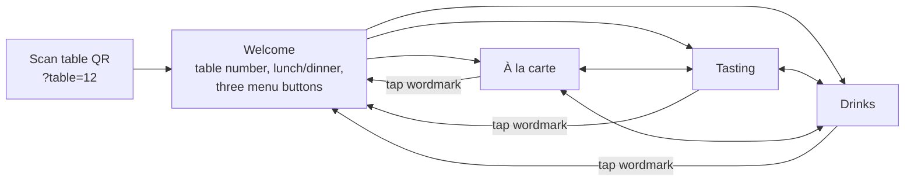

# Apricity table menu mockup

A phone-first menu that guests open by scanning the QR code on their table.

- `index.html`: open it in a browser (or a phone-sized dev-tools window). Add `?table=12` to the URL to see how a table-specific QR code works.
- `src/menu.html`: the same page without the document wrapper (used for the hosted preview). Edit this file, then rebuild `index.html` (it is `src/menu.html` wrapped in a standard `<head>`/`<body>`).

Dishes, prices and wording are **samples for layout only**. A few real items (wasted dip with oat & fennel cracker, mac 'n' cauliflower kimcheese, chouxnut, Crown & Queue cured meats, sourdough £6) and the published price ranges and tasting-menu prices come from public sources. Everything else is placeholder.

## User flow

1. **Scan → Welcome.** The QR code holds the table number, so the page greets the table ("Table 12") and shows whether lunch or dinner is being served. Three large buttons: À la carte (highlighted as the most common choice), Tasting menu (the "from" price changes to the lunch price at lunchtime) and Drinks. The allergen prompt and the PB/V key sit underneath, so guests see them before they choose.
2. **One tap to any menu.** A sticky bar holds three equal tabs (À la carte · Tasting · Drinks). Guests can switch between food and drinks from anywhere without going back.
3. **Find the section.** Under the tabs, a row of section chips (Snacks, Starters, Mains… or Cocktails, Low & no, Wine…) jumps to a section. The chip for the section on screen lights up as the guest scrolls.
4. **Filter for plant-based.** On à la carte, "Plant-based only" hides everything else. The choice is remembered on the guest's phone. A section with no plant-based dish says so and suggests asking the server.
5. **Tasting menu.** Two toggles (5 / 7 courses, Plant-based / Omnivore) update the course list and price together. At lunch it shows the lunch price, the group-size condition and the dinner price.
6. **Getting back.** The phone's back button moves between menus as expected. Tapping the wordmark returns to Welcome.
7. **Every menu ends** with the allergen note and a line on Apricity's low-waste approach.

## Design notes

- The look takes its cue from the name (warmth from winter sun): a frosty pale ground, evergreen ink, and a low "winter sun" accent. A sun rising over the horizon line on the welcome screen is the one decorative moment.
- Dark mode follows the phone setting, which helps in a dimly lit dining room.
- Large tap targets, one column, no pinch-zoom PDFs, and no pop-ups.
- The visual style was not compared with apricityrestaurant.com, because this environment's network policy blocked that site. Colours and fonts are tokens at the top of the `<style>` block, so they can be swapped to match the brand.
