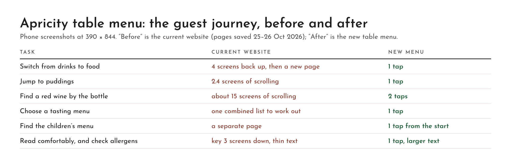

# Screenshots: the guest journey, before and after

Phone screenshots at 390 × 844. "Before" is the current website, rendered from saved copies of its A la carte, Tasting menus, Drinks, Wine List and Culinary Kids pages (25–26 Oct 2026). "After" is the new table menu.

## Boards (before and after, by task)

| Task | Current website | New menu | Board |
| --- | --- | --- | --- |
| Switch from drinks to food | 4 screens back up to the menu links, then a new page | 1 tap | [1-switch-drinks-to-food.png](boards/1-switch-drinks-to-food.png) |
| Jump to puddings | 2.4 screens of scrolling | 1 tap | [2-jump-to-puddings.png](boards/2-jump-to-puddings.png) |
| Find a red wine by the bottle | About 15 screens of scrolling, inside a box that scrolls separately from the page | 2 taps | [3-find-a-red-wine.png](boards/3-find-a-red-wine.png) |
| Choose a tasting menu | One combined list, with 7-course-only courses marked inside it | 1 tap | [4-choose-a-tasting-menu.png](boards/4-choose-a-tasting-menu.png) |
| Find the children's menu | A separate page, reached from the Menus page only | 1 tap from the start page | [5-find-the-kids-menu.png](boards/5-find-the-kids-menu.png) |
| Read comfortably and check allergens | Key about 3 screens down, below every dish; thin, small grey text | 1 tap to the key; 17px text and a *Larger text* button | [6-read-and-check-allergens.png](boards/6-read-and-check-allergens.png) |

All six on one page: [storyboard.png](boards/storyboard.png).

## How the distances were measured

The website's mobile layout is 320px wide and shown scaled up 1.22× on a 390px phone, so one phone screen is 693px of the page. Positions come from the saved pages:

| Page | Measured | Page position | Phone screens |
| --- | --- | --- | --- |
| Drinks | Whole page, end to top | 3,315px | 4.8 (about 4 back up from the last screen) |
| A la carte | Puddings heading | 1,682px | 2.4 |
| A la carte | Allergen key | 2,033px | 2.9 |
| Tasting menus | First course ("Choose one dish per course") | 949px | 1.4 |
| Wine List | "Red — Soft & Juicy" (first bottle reds), inside the wine list box | 10,535px | 15 |

The menu content in these saved pages matches the spreadsheets in `sheets/`.

## Single screens

**Current website** (`before/`)
- `web-drinks-top.png`, `web-drinks-bottom.png`: the Drinks page, top and end.
- `web-alacarte-top.png`, `web-alacarte-starters.png`, `web-alacarte-key.png`: the A la carte page, top, starters and allergen key.
- `web-tasting-top.png`, `web-tasting-middle.png`: the Tasting menus page, prices and the middle of the course list.
- `before-1-wine-top.png`, `before-2-wine-rows.png`, `before-3-wine-end.png`: the Wine List page.
- `before-4-kids-top.png`: the Culinary Kids page.

**New menu** (`after/`)
- `after-1-start.png`: the start page.
- `after-2-drinks.png`, `after-drinks-end.png`: Drinks, top and end (with *Food menu →*).
- `after-3-wine-red.png`: after tapping *Red: Soft & Juicy*.
- `after-4-alacarte-plant.png`, `after-alacarte-puddings.png`: A la carte with *Plant-based* on, and after tapping *Puddings*.
- `after-tasting-5.png`, `after-tasting-7-middle.png`, `after-5-kids.png`: Tasting with 5 courses, 7 courses and Kids.
- `after-6-larger-text.png`: A la carte at the largest text size.
- `after-7-allergen-key.png`: the allergen key opened from the allergy note.
